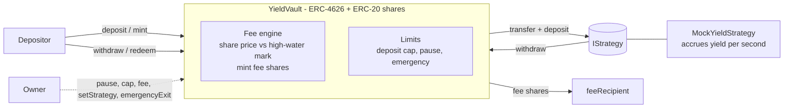

# ERC-4626 Yield Vault (personal demo project)

> **Status: personal portfolio / learning project. UNAUDITED. Not client work. Never deployed. Do not use with real funds.**
> There are no users, no TVL and no audits. Everything below describes code in this repository and test results I ran locally.

An ERC-4626 tokenised vault in Solidity `^0.8.24` (built on OpenZeppelin v5.1.0) that deposits into a **pluggable strategy**, charges a **performance fee with a high-water mark**, enforces a **deposit cap**, supports **pause / emergency withdraw-only mode**, and defends against the **share-inflation (donation) attack** using virtual shares/assets.

## Features

| Feature | Where | Notes |
|---|---|---|
| ERC-4626 vault | `src/YieldVault.sol` | `totalAssets = idle balance + strategy.totalAssets()` |
| Pluggable strategy | `src/interfaces/IStrategy.sol` | `asset() / totalAssets() / deposit() / withdraw()`; owner can migrate (`setStrategy`) |
| Performance fee + HWM | `YieldVault._pendingFee/_chargeFees` | fee (max 30%) is taken as **minted shares** to `feeRecipient`, only on share-price gains above the high-water mark; settled lazily before every deposit/withdraw/admin change; previews already include the pending fee, so `preview*` == execution |
| Deposit cap | `maxDeposit / maxMint` | cap applies to total assets; yield may push TVL above cap but deposits stay blocked |
| Pause / emergency | `pause, unpause, emergencyExit` | pause blocks deposits/mints only; **withdrawals/redemptions are never blocked**; `emergencyExit` also pulls everything out of the strategy |
| Inflation-attack defence | `_decimalsOffset() = 6` | OZ virtual shares (1e6) + virtual asset (+1) |
| Mock yield strategy | `src/mocks/MockYieldStrategy.sol` | per-second yield + `donateYield` / `simulateLoss` helpers for tests |
| Access control | `Ownable2Step` | single owner role (no timelock/multisig in this demo) |
| Safety | `ReentrancyGuard`, `SafeERC20`, custom errors, events, NatSpec | |

## Architecture



```
 user --deposit--> [ YieldVault ] --idle funds--> [ IStrategy ]  (yield accrues here)
 user <-redeem---- [  shares   ] <--withdraw----- [ MockYieldStrategy ]
                        |
                        +-- on every state change: if sharePrice > highWaterMark
                            mint feeBps% of the excess value as shares -> feeRecipient
                            highWaterMark = new (post-dilution) price
```

### Fee math (short)
`sharePrice = (assets+1) * 1e27 / (supply + 1e6) * 1e6`. If `price > hwm`: `excess = assets * (price-hwm)/price`, `feeAssets = excess * feeBps/1e4`, `feeShares = feeAssets * (supply+1e6) / (assets - feeAssets + 1)` (rounded down, i.e. in favour of holders). A loss followed by recovery to the old price pays no fee because `hwm` never decreases.

### Inflation / donation attack
Classic attack: attacker deposits 1 wei, donates a big amount straight to the vault so the share price explodes, and the next depositor's shares round to 0. Here the 1e6 virtual shares mean the attacker's donation is mostly captured by the virtual position, so the attack loses money.
`test/InflationAttack.t.sol` contains:
* a deliberately **naive vault** that the same attack **does** drain (control experiment),
* the identical attack on `YieldVault` (victim deposits 10,000 tokens after a 10,000-token donation): measured victim loss = **2,500,000,625,000,156 wei (~0.0025 token, 2.5e-7 of the deposit)**, attacker loss = **4,999,998,749,999,687,499,922 wei (~5,000 tokens)** - attack is a net loss,
* two fuzz tests (attacker never profits; victim loss bounded and shares never round to zero when victim deposits >= the donation).

## Security considerations / known limitations

* **Unaudited personal demo.** Treat as educational code.
* **Trust model:** the owner is fully trusted (can pause, change cap/fee up to 30%, migrate strategy, emergency-exit). No timelock or multisig. The strategy is trusted: a malicious/buggy strategy can misreport `totalAssets` or lose funds.
* **Donations count as yield.** Tokens sent directly to the vault (or strategy) raise the share price and are therefore subject to the performance fee.
* **Offset trade-off:** 6 virtual decimals bound the first-depositor/rounding loss to roughly 1e-6 relative; amounts of a few wei can round to zero shares. The vault does not enforce a minimum deposit.
* **Rounding dust regime:** with a vault holding only a few wei, a 1-wei change can move the fee/price by a visible fraction (see invariant caveats below).
* **Withdrawals depend on strategy liquidity** (`InsufficientLiquidity` if the strategy cannot return enough). `emergencyExit` is the escape hatch.
* **Fee shares accrue lazily**; the fee recipient is diluted/credited consistently because previews include the pending fee.
* Not modelled: ERC-4626 `maxWithdraw/maxRedeem` strategy-liquidity limits, fee-on-transfer/rebasing assets, multi-strategy allocation, oracle/price manipulation of real strategies.

## Run the tests

Foundry does not need to be installed; Docker is enough.

```bash
# 1. dependencies (pinned: OpenZeppelin v5.1.0, forge-std 1.17.0-era master; lib/ is git-ignored)
docker run --rm -v "$PWD":/app -w /app --entrypoint forge ghcr.io/foundry-rs/foundry \
  install --no-git OpenZeppelin/openzeppelin-contracts@v5.1.0 foundry-rs/forge-std

# 2. all tests
docker run --rm -v "$PWD":/app -w /app --entrypoint forge ghcr.io/foundry-rs/foundry test

# gas snapshot / coverage
docker run --rm -v "$PWD":/app -w /app --entrypoint forge ghcr.io/foundry-rs/foundry snapshot
docker run --rm -v "$PWD":/app -w /app --entrypoint forge ghcr.io/foundry-rs/foundry coverage --no-match-coverage "test|lib"
```
Tested with `forge 1.8.1` and solc 0.8.24 (optimizer 200 runs).

## Test results (real output from my local run)

`forge test` summary: **40 passed, 0 failed, 0 skipped** (Forge counts the whole invariant contract as 1 test; counting each invariant function separately there are **45 test functions**).

| Suite | Functions | Result |
|---|---|---|
| `test/YieldVault.t.sol` (28 unit + 7 fuzz, 512 runs each) | 35 | 35 passed |
| `test/InflationAttack.t.sol` (2 unit + 2 fuzz, 512 runs each) | 4 | 4 passed |
| `test/invariant/YieldVaultInvariant.t.sol` (6 invariants, 128 runs x depth 64 = 8,192 calls each) | 6 | 6 passed |

Invariants (random sequences of deposit / mint / redeem / withdraw / yield / time-warp / loss / harvest / pause / fee change by 4 actors):
1. `totalAssets >= sum of redeemable value` of all holders (incl. fee recipient)
2. `totalAssets == idle balance + strategy.totalAssets()`
3. share price never decreases absent a loss (tolerance: <= 1e-9 relative dip; check skipped when TVL < 1e12 wei)
4. fee only on gains: no yield => no fee shares; value of fee shares at mint time <= `feeBps` x cumulative gross gains (+1e-12 rounding slack)
5. high-water mark never below its initial value
6. total assets never exceed `cap + cumulative gains`

Extra confidence checks I ran (not part of the default run): 3 stress runs with 800 invariant runs x depth 120 (96,000 calls each) and 3,000 fuzz runs - all passed; and mutation checks - removing the HWM comparison, or never raising the HWM, makes unit tests and invariants fail as expected.

Coverage (`forge coverage`): `YieldVault.sol` 97.6% lines / 78.3% branches; total src 97.6% lines.

Approximate gas (from `forge test --gas-report`, single runs): `deposit` ~114k-165k, `redeem` ~100k-126k, `emergencyExit` ~90k. Full per-test snapshot in `.gas-snapshot`.

### Issues found while testing (honest log)
While writing the invariants, the fuzzer found two real precision effects that I fixed or documented rather than hid: (1) price quantisation at 1e18 let the fee exceed `feeBps` of the gain by up to ~1e9 wei at 1e27 TVL - fixed by raising the price scale to 1e27; (2) in a dust regime (a few wei of TVL) share price can dip by sub-wei rounding after a 1-wei gain - documented and excluded from invariant 3.

## Layout
```
src/YieldVault.sol               vault
src/interfaces/IStrategy.sol     strategy interface
src/mocks/                       MockERC20, MockYieldStrategy
test/Base.t.sol                  shared setup
test/YieldVault.t.sol            unit + fuzz
test/InflationAttack.t.sol       naive-vs-protected attack demo + fuzz
test/invariant/                  handler + invariants
.gas-snapshot                    forge snapshot output
```
